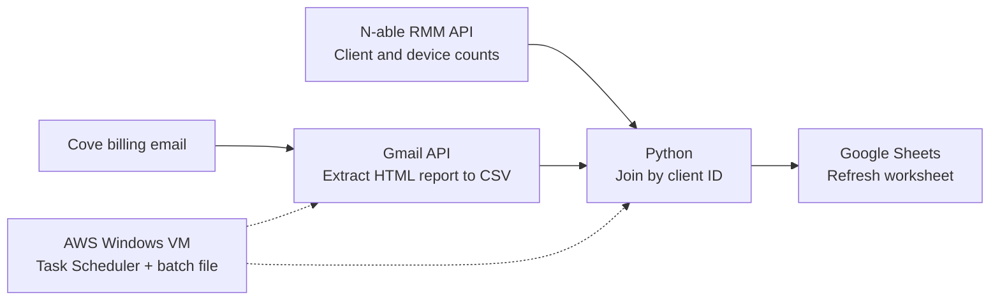

# MSP Client Inventory Sync

Python automation I built to keep an MSP's Google Sheet up to date with each client's workstations, servers, and Microsoft 365 backup billing counts. The original ran unattended on a Windows VM hosted in AWS, using a batch file and Windows Task Scheduler.

This repository is an independent, sanitized demonstration of that workflow, not the original employer code. All sample clients are fictional.

## How it worked



Two Python scripts handled the work: one read the latest matching Cove billing email and generated a CSV from its HTML table; the other fetched N-able client inventory, matched `Partner reference` to client ID, and refreshed a Google Sheets worksheet. Task Scheduler ran the scripts on the VM.

The sheet tracked client name, servers, workstations, and `Total M365 billable users`. That last figure came from **Cove billing**, not a live audit of backup coverage. Missing values remained blank; unknown partner references were flagged.

## Run the sample

Python 3.10+.

```powershell
python -m pip install -r requirements.txt
python gmail_billing.py --html samples/cove_email.html --output output/m365_billing.csv
python inventory_sync.py --billing output/m365_billing.csv
```

This processes a fictional billing email and N-able XML export without contacting any APIs. The resulting `output/client_inventory.csv` contains:

| Client | Servers | Workstations | M365 billable users |
| --- | ---: | ---: | ---: |
| Beacon Architecture | 1 | 26 | 24 |
| Birchwood Dental | 2 | 18 | 22 |
| Cedarline Manufacturing | 4 | 42 | 48 |
| North Ridge Realty | 0 | 11 | — |

The sample includes an unmatched billing reference to demonstrate how missing client mappings are detected.

## Running unattended on Windows

The included `run-sync.bat` is an **example of the original scheduling approach**, not a copy of the production task. It runs the Gmail-to-CSV step before the inventory-to-Sheets step and exits on failure.

1. On the Windows VM, create a virtual environment and install the dependencies: `py -m venv .venv`, then `.venv\Scripts\python.exe -m pip install -r requirements.txt`.
2. Copy `config\run.local.example.bat` to `config\run.local.bat` and set your own values. The real configuration file is Git-ignored.
3. Create a Google OAuth desktop-app client for Gmail read-only access. Sign in interactively once using the **same Windows account** that will run the scheduled task, so the stored token can be refreshed without opening a browser on every run. Store the OAuth client and token JSON outside the repository.
4. Give a Google Sheets service account edit access to a dedicated worksheet. Set the spreadsheet ID, worksheet name and private service-account JSON path in the local config.
5. Configure an N-able HTTPS client inventory endpoint and your Gmail search query. Make the query restrictive enough to identify the correct report, ideally including sender and subject.
6. In Windows Task Scheduler, create a task for the chosen interval. Run `cmd.exe` with arguments `/c "C:\path\to\repo\run-sync.bat"`, under the configured account. Set the working directory and review Task Scheduler history/output when it fails.

The batch file executes each script in order. It won't publish a new sheet if email retrieval fails. To test the inventory synchronization without Gmail, run `inventory_sync.py` directly with `--billing path\to\report.csv`.

For a live manual run, `inventory_sync.py --live --billing output/m365_billing.csv --publish` uses `NABLE_CLIENTS_URL` and the configured Google Sheets credentials. Use a **dedicated worksheet**: rows in columns A–E are replaced, and leftover cells are cleared. Sheet updates aren't transactional.

## Notes

- The original Gmail script parsed an **HTML table inside the email** into a CSV; it didn't download an attached CSV file. The sample follows that implementation.
- A failed or unrecognized email leaves the previous billing CSV intact. The scheduled batch exits before publishing, avoiding a silent refresh from stale data.
- Both Gmail OAuth and Google Sheets service-account credentials must stay private. The N-able endpoint may contain an API key; don't commit it, or put private exports in the repository.
- The live integrations and Windows/AWS scheduled run have not been tested as part of this public demo. The sample pipeline and unit tests run locally.

Run tests with `python -m unittest discover -s tests -v`.
