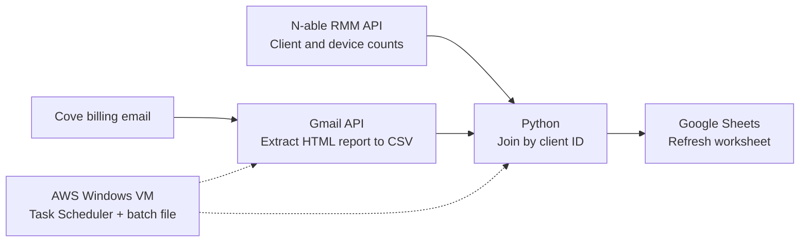

# MSP Billing Sync

I built this Python automation to reconcile N-able RMM device counts and Cove Microsoft 365 billing data in an MSP's Google Sheets inventory. It ran unattended on an AWS-hosted Windows VM using Windows Task Scheduler and a batch file.

## Workflow



`gmail_billing.py` uses a Gmail search query to retrieve a Cove billing email and extract its HTML report table into a CSV. The report is read from the email body, not an attachment.

`inventory_sync.py` reads N-able client inventory XML and matches client IDs to the billing CSV's `Partner reference`, ignoring case and surrounding whitespace. It writes the reconciled inventory to a local CSV and optionally publishes it to Google Sheets.

Clients without a billing match retain a blank M365 count. Billing references without an inventory match are reported in the console. Duplicate IDs and invalid counts cause the run to fail. M365 counts represent Cove billable users, not verified backup coverage.

## Setup and sample run

Use Python 3.10 or later. From the repository directory in PowerShell:

```powershell
py -m venv .venv
.\.venv\Scripts\python.exe -m pip install -r requirements.txt
.\.venv\Scripts\python.exe gmail_billing.py --html samples/cove_email.html --output output/m365_billing.csv
.\.venv\Scripts\python.exe inventory_sync.py --billing output/m365_billing.csv
```

These commands process the fictional billing email and `samples/clients.xml` without API calls or live credentials. The result is `output/client_inventory.csv`:

| Client ID | Client Name | Servers | Workstations | M365 Billable Users |
| --- | --- | ---: | ---: | ---: |
| 10001 | Beacon Architecture | 1 | 26 | 24 |
| 10002 | Birchwood Dental | 2 | 18 | 22 |
| 10003 | Cedarline Manufacturing | 4 | 42 | 48 |
| 10004 | North Ridge Realty | 0 | 11 | |

The console also reports unmatched billing reference `19999`. To use other exports, pass `--inventory path/to/clients.xml` and `--billing path/to/billing.csv`. The billing CSV requires `Partner reference` and `Total M365 billable users` columns. Use `--exclude CLIENT_ID` to omit a client; repeat it for multiple clients. `--output` changes the CSV destination.

Run the unit tests with:

```powershell
.\.venv\Scripts\python.exe -m unittest discover -s tests -v
```

## Gmail and Google Sheets configuration

Copy `config\run.local.example.bat` to `config\run.local.bat` and replace the placeholders. The local file is Git-ignored.

| Setting | Purpose |
| --- | --- |
| `GMAIL_OAUTH_CLIENT_FILE` | Path to the Gmail OAuth desktop-app client JSON |
| `GMAIL_TOKEN_FILE` | Path for the saved OAuth token |
| `GMAIL_SEARCH_QUERY` | Gmail query identifying the Cove report; include sender and subject |
| `GOOGLE_CREDENTIALS_FILE` | Path to the Google Sheets service-account JSON |
| `GOOGLE_SHEET_ID` | Target spreadsheet ID |
| `GOOGLE_WORKSHEET` | Existing worksheet name |

Enable the Gmail and Google Sheets APIs in the relevant Google Cloud projects. Create an OAuth desktop-app client for Gmail read-only access and a Sheets service account with edit access to the target spreadsheet. Store credentials outside the repository, restrict access to the task's Windows account, and keep API keys and private exports out of version control.

For a manual run using Gmail and a saved N-able XML export, use Command Prompt:

```bat
call config\run.local.bat
.venv\Scripts\python.exe gmail_billing.py --output output\m365_billing.csv
```

The first Gmail run opens a browser for authorization. Complete it under the Windows account that will run the scheduled task; subsequent runs can refresh the saved token. After the Gmail command succeeds, reconcile and publish:

```bat
.venv\Scripts\python.exe inventory_sync.py --inventory "C:\path\to\clients.xml" --billing output\m365_billing.csv --publish
```

Use a dedicated worksheet: publishing overwrites columns A-E from row 1, including headers, then clears obsolete rows in those columns. These operations are not transactional. Omit `--publish` to write only the local CSV.

## Scheduled execution

`run-sync.bat` sets the working directory, loads the local configuration, runs Gmail extraction, then calls inventory synchronization with `--live --publish`. It stops if either script fails. Failed email retrieval or parsing preserves the previous billing CSV without proceeding to publication.

Live N-able retrieval is not configured: `--live` uses a hardcoded `API_URL` containing `YOUR_API_KEY` and ignores `NABLE_CLIENTS_URL` in the configuration example. The batch file requires this connection to be configured in the code before use. The manual workflow above uses a saved XML export.

After a successful manual batch run, create a Windows scheduled task using `cmd.exe` with arguments `/c "C:\path\to\repo\run-sync.bat"`. Select the account used for Gmail authorization, set the desired interval, and enable execution while logged off. Check the task's exit status and capture console output for troubleshooting.
